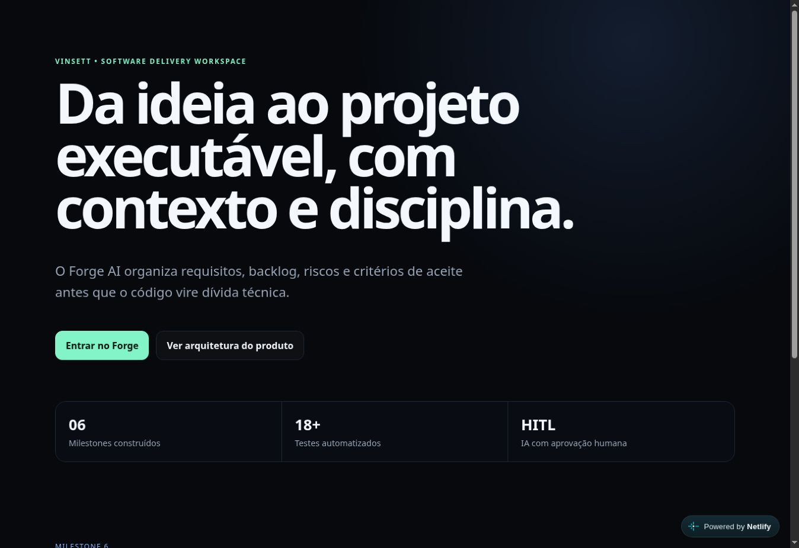
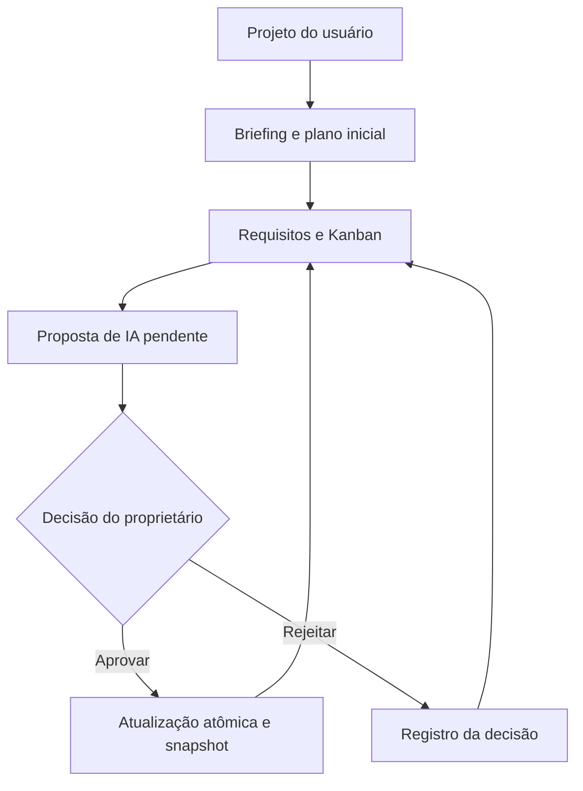

# VINSETT Forge AI

[](https://github.com/Vinsett07/vinsett-forge-ai/actions/workflows/ci.yml)

**v0.6.2 — workspace de planejamento e acompanhamento de projetos de software, com IA e aprovação humana.**

O VINSETT Forge AI foi criado para transformar uma ideia em trabalho organizado: briefing, plano versionado, requisitos, critérios de aceite, tarefas e histórico. O proprietário revisa as sugestões da IA antes de aplicá-las ao projeto.

[Abrir o site](https://vinsett-forge-ai.netlify.app/) · [Estudo de caso para portfólio](docs/PORTFOLIO_CASE_STUDY.md) · [Revisão de 12/10/2026](docs/PROJECT_STATUS_2026-10-12.md)



Os seis marcos estão implementados, com site próprio na Netlify, separado do Academy. Cadastro, persistência, integração GitHub e IA externa com aprovação foram verificados em produção em 04/10. A restauração real do backup foi validada em ambiente isolado em 05/10. Em 12/10, a saúde pública e o CI passaram novamente. Ainda há pendências de acesso para encerrar a operação; consulte a lista abaixo.

## O que funciona

- Cadastro, entrada e saída, sessões assinadas em cookie HttpOnly e senhas protegidas com `scrypt` e salt.
- Projetos persistidos em PostgreSQL/Drizzle, com acesso limitado ao proprietário.
- Briefing estruturado, plano inicial determinístico e snapshots versionados.
- Requisitos, critérios de aceite, Kanban de cinco etapas e histórico de atividades.
- Propostas de IA salvas como pendentes; aprovação aplica plano, requisitos e tarefas em uma transação. Rejeição registra a decisão.
- Provedor determinístico para uso sem chave externa e adaptador OpenAI Responses. Uma falha do provedor externo configurado é exibida, sem substituição silenciosa.
- Contexto GitHub de leitura: repositório, issues, pull requests, commits e execuções do Actions. O site público usa repositórios públicos.
- Endpoint de saúde, cabeçalhos de segurança, limites de requisições por processo e configuração de publicação.

O Forge organiza o desenvolvimento e acompanha seu contexto. A versão atual não gera nem publica código de aplicações automaticamente, e não oferece colaboração entre organizações.

## Como funciona



## Arquitetura

| Responsabilidade | Implementação |
| --- | --- |
| Interface e API | Next.js App Router, React, TypeScript |
| Domínio | Contratos e validadores TypeScript sem dependências externas |
| Persistência | PostgreSQL, Drizzle ORM, nove tabelas e quatro migrações SQL ordenadas |
| Autenticação | `scrypt`, cookie HttpOnly assinado com HMAC |
| IA | Propostas validadas, metadados de auditoria e aprovação humana explícita |
| GitHub | Adaptador REST somente de leitura |
| Hospedagem | Netlify, banco gerenciado e AI Gateway |
| Validação | Testes Node, ESLint, TypeScript, build e Playwright com PostgreSQL |

## Executar localmente

Requer Node.js 22.13+ e PostgreSQL. Copie `.env.example` para `.env.local`, configure `DATABASE_URL` e um `SESSION_SECRET` aleatório com pelo menos 32 caracteres. Use `AI_PROVIDER=deterministic` para começar sem chave externa. Nunca versione credenciais.

```bash
npm ci
node --env-file=.env.local scripts/migrate.mjs
npm run dev
```

O comando de migração acima carrega `.env.local`; `npm run db:migrate` espera variáveis já exportadas. O executor local e a Netlify usam os arquivos SQL em `netlify/database/migrations`. A Netlify controla as migrações e sua aplicação antes de publicar em produção. Consulte o [procedimento operacional](docs/OPERATIONS.md) antes de alterar o banco.

## Validar

```bash
npm run lint
npm run typecheck
npm test
npm run build
npx playwright install chromium
```

Execute os testes de navegador somente com banco descartável. Eles criam contas e projetos de teste, verificam decisões sobre propostas e excluem o projeto de teste:

```bash
node --env-file=.env.local node_modules/@playwright/test/cli.js test
```

O GitHub Actions usa PostgreSQL 17, reaplica as quatro migrações, executa lint, checagem de tipos, 19 testes unitários, 11 cenários transacionais de proteção da limpeza, build e três testes Chromium sobre o servidor gerado pelo build. Relatórios e traces ficam retidos por sete dias. A jornada cobre cadastro, persistência, Kanban, isolamento entre usuários, aprovação, rejeição, decisões duplicadas/concorrentes, saída, nova entrada e exclusão. Fora do CI, os cenários de limpeza só são habilitados com um banco descartável explícito; consulte [ops/README.md](ops/README.md).

## Entregas e pendências

| Marco | Estado verificado |
| --- | --- |
| M1 — Fundação | Implementado |
| M2 — Autenticação e persistência | Validado no CI e por HTTP em produção |
| M3 — Workspace de execução | Jornada de banco e navegador validada no CI |
| M4 — IA com revisão humana | Provedor externo e aprovação validados em produção |
| M5 — Contexto GitHub | Vínculo e sincronização de repositório público validados em produção |
| M6 — Operação | Site, banco, saúde, CI e restauração isolada do backup verificados |

Pendências registradas na [revisão atual](docs/PROJECT_STATUS_2026-10-12.md):

- Publicar as seis tags históricas preservadas, usando uma credencial Git com acesso de escrita ao repositório e permissão de workflows.
- Limpar as duas branches descartáveis do ensaio de restauração e a conta/projeto sintéticos de aceite. A [migração de limpeza está preparada e testada](ops/README.md), fora das migrações ativas. A exclusão das branches exige o painel autenticado, e a aplicação da limpeza exige um deploy autorizado.
- Completar a jornada autenticada pelo navegador no domínio público. Essa jornada já passa no CI; o aceite autenticado de produção foi realizado por HTTP.

O projeto já pode ser apresentado como um MVP funcional publicado, com evidências técnicas e essas limitações explícitas. O [estudo de caso](docs/PORTFOLIO_CASE_STUDY.md) reúne o conteúdo para o novo portfólio.

## Documentação

- [Revisão atual e próximos passos](docs/PROJECT_STATUS_2026-10-12.md)
- [Roadmap](docs/ROADMAP.md)
- [Arquitetura](docs/ARCHITECTURE.md)
- [Camada de IA](docs/AI_LAYER.md)
- [Integração GitHub](docs/GITHUB_INTEGRATION.md)
- [Operação e backup](docs/OPERATIONS.md)
- [Restauração comprovada em 05/10/2026](docs/BACKUP_RESTORE_2026-10-05.md)
- [Estudo de caso para portfólio](docs/PORTFOLIO_CASE_STUDY.md)
- [Evidências de validação](docs/VALIDATION.md)
- [Biblioteca de código aberto (10 repositórios)](docs/OPEN_SOURCE_TOOLKIT.md)
